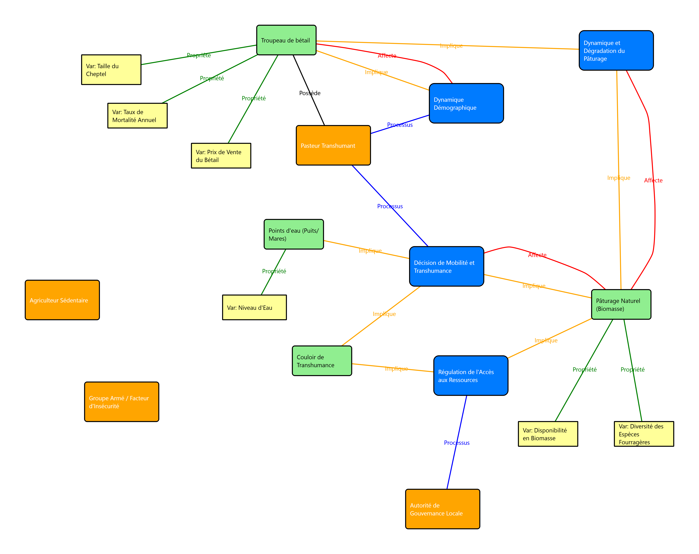

# Développement d’un éditeur Python basé sur un métamodèle EMF avec export en .xmi

Ton métamodèle (au format Ecore/XMI) définit les concepts. En Python, tu peux :

- **Charger et manipuler** ton métamodèle (instances) grâce à des bibliothèques comme `pyecore`.
- **Éditer le modèle** via une interface graphique (ex. PyQt5/PySide, Tkinter, voire un éditeur web via PyScript/React).
- **Sauvegarder / partager** les instances directement en `.xmi` (`pyecore` le fait nativement).

Cela te donne une alternative **plus flexible** à Sirius, tout en respectant l’ingénierie dirigée par les modèles (IDM/MDE), car :

- Le métamodèle reste la **source de vérité**.
- Les modèles instanciés sont stockés en `.xmi`.
- L’éditeur est juste une couche de **visualisation/manipulation**.

---

## 🔹 Étape 1 : Les briques nécessaires

- **Python + pyecore** → pour manipuler le métamodèle et créer des instances.

  ```bash
  pip install pyecore

  python -m venv venv
  venv/bin/pip install --upgrade pip
  pip install PySide6 pyecore
  # Optionnel : pygraphviz / networkx pour layout automatique
  pip install networkx graphviz

  pip install lxml

  pip install svgwrite # n'est plus utilise

  pip install pymupdf

  pip install reportlab
  ```

- Ton métamodèle exporté en .ecore (ou .xmi) depuis Eclipse EMF/Sirius.
  Un script Python minimal qui :

- Charge ton métamodèle.
- Instancie quelques objets (Actor, Resource, etc.).
- Sérialise en .xmi.

Exemple de squelette minimal (adapté à ton métamodèle)

```python
from pyecore.resources import ResourceSet, URI

# Charger ton métamodèle
rset = ResourceSet()
mm = rset.get_resource(URI('file:SocioEcosystem.ecore')).contents[0]
rset.metamodel_registry[mm.nsURI] = mm

# Créer une ressource pour ton modèle
resource = rset.create_resource(URI('file:example_model.xmi'))

# Instancier un élément du métamodèle (exemple Actor)
Actor = mm.getEClassifier('Actor')
actor1 = Actor(name="Berger")

# Ajouter au modèle
resource.append(actor1)

# Sauvegarder
resource.save()
```

# Étape 2 : Construire l’éditeur

## Choix stratégiques

Deux approches possibles pour l’éditeur :

- **Éditeur textuel** (console ou fichier YAML/JSON) :
  - Plus simple pour débuter.
- **Éditeur graphique** (GUI) :
  - Plus proche de Sirius.

### Technologies suggérées

- **Python** :
  - PyQt5, PySide6, Tkinter, etc.
- **Web** :
  - React ou Vue avec une API Python (FastAPI ou Flask).

---

# Étape 3 : Stratégie de développement pas à pas

1. **Charger et instancier le métamodèle** :
   - Réalisé (✔ voir étape 1 ci-dessus).
2. **Créer une API Python** :
   - Permettre l’ajout/suppression d’éléments (`Actors`, `Resources`, `Relations`).
3. **Sauvegarder/ouvrir un fichier .xmi** :
   - Gérer la persistance des modèles.
4. **Ajouter une interface simple** :
   - Liste des éléments avec un bouton d’ajout.
5. **Étendre vers une interface graphique** :
   - Support pour l’édition de graphes avec nœuds et arêtes.

---

# 🚀 Proposition

Avancer en itérations simples :

1. **Prototype Python minimal** :
   - Charger le fichier `.ecore`.
   - Créer un modèle avec quelques instances.
   - Sauvegarder en fichier `.xmi`.

2. **Ajouter les opérations CRUD** :
   - Fonctionnalités pour ajouter, supprimer, modifier un `Actor`, une `Resource`, ou une arête.

3. **Réfléchir à l’éditeur visuel** :
   - Planifier l’implémentation d’une interface graphique pour l’édition.

   # Recommandation (simple & directe)

**Choix recommandé** : PySide6 (Qt6 for Python).  
Si pour une raison pratique vous préférez l’autre binding Qt, **PyQt5** est une alternative viable.  
**Évitez Tkinter** pour un véritable éditeur de diagrammes (trop limité graphiquement).

---

## Pourquoi PySide6 (résumé)

- **Framework graphique riche** : `QGraphicsScene` / `QGraphicsView` est fait pour des éditeurs graphiques (nœuds, arêtes, zoom, pan, sélection, groupe, calques, collisions, animations).
- **Performance** : Qt est optimisé pour gérer des centaines / milliers d’items graphiques.
- **Widgets prêts à l’emploi** : docks (propriétés), palettes d’outils, menus, undo/redo (`QUndoStack`), éditeurs inline, dialogs.
- **Licences** : PySide6 est LGPL (plus souple pour usage entreprise). PyQt5 est GPL/commercial (attention licence).
- **Futur-proof** : Qt6 / PySide6 est la voie moderne ; API proche de PyQt mais sans contraintes de licence commerciale.
- **Écosystème & outillage** : Qt Designer, styles, ressources, packaging (PyInstaller), support multi-plateforme.

---

## Comparatif rapide

| Critère                              | PySide6         | PyQt5            | Tkinter                |
| ------------------------------------ | --------------- | ---------------- | ---------------------- |
| **Support QGraphicsView (éditeur)**  | ✅ Optimal      | ✅               | ❌ Très limité         |
| **Licence**                          | LGPL (souple)   | GPL / commercial | BSD-like (mais limité) |
| **Documentation / exemples**         | Très bon        | Très bon         | Bon mais simple        |
| **Outils visuels (Designer)**        | ✅              | ✅               | ❌                     |
| **Courbe d’apprentissage**           | Moyenne         | Moyenne          | Très faible            |
| **Idéal pour éditeur de diagrammes** | Oui (fortement) | Oui              | Non                    |

---

## Fonctionnalités Qt utiles pour un éditeur MDE

- **QGraphicsScene / QGraphicsItem** : Nœuds/edges personnalisés.
- **Sélection multiple, drag/drop, snapping, guides**.
- **QGraphicsLineItem / custom** : Edges avec routage orthogonal.
- **QUndoStack** : Undo/redo pour opérations CRUD sur le modèle.
- **QDockWidget** : Palette + propriété (édition d’attributs comme `pseudoCode`, `equation`…).
- **Export** : PNG/PDF, copy/paste, zoom, grid.
- **Intégration facile avec pyecore** : Couche modèle.

---

## Intégration avec ton flux MDE (pyecore)

- **Modèle** : `pyecore` pour charger `.ecore` et sérialiser `.xmi`.
- **Vue** : PySide6 `QGraphicsView`.
- **Contrôleur** : Actions Qt qui traduisent les interactions utilisateur → opérations `pyecore` (create/remove/set).
- **Undo/Redo** : Wrap des opérations modèle dans des commandes `QUndoCommand` personnalisées.

# Plan d’action pas-à-pas recommandé (suite)

## Prototype minimal PySide6

- **Objectif** : Créer une interface avec une fenêtre contenant :
  - `QGraphicsView` pour la visualisation graphique.
  - Palette avec boutons pour créer : `Actor`, `Resource`, `Process`, `Interaction`.
  - Création visuelle d’un nœud.

## Liaison au modèle

- À la création visuelle d’un élément :
  - Créer l’instance `pyecore` correspondante.
  - Attacher l’instance au `SocioEcosystem`.
- Sauvegarde du modèle en fichier `.xmi`.

## CRUD complet

- **Édition** : Modifier les attributs via un dock (interface dédiée).
- **Suppression** : Gérer la suppression avec distinction entre :
  - `Remove` (suppression logique du modèle).
  - `DeleteView` (suppression de la vue graphique uniquement).
- **Création d’arêtes** : Sélectionner une source, puis une cible pour créer des relations.
- **Gestion des références** : Distinguer entre relations de containment et non-containment.

## Undo/Redo

- Utiliser `QUndoStack` pour gérer l’historique des actions sur le modèle (annuler/refaire).

## Améliorations

- **Layout automatique** : Positionnement optimisé des nœuds.
- **Styles** : Personnalisation visuelle des éléments (e.g., couleurs, formes).
- **Export** : Sauvegarde ou exportation dans d’autres formats.
- **Validation** : Vérification de la cohérence du modèle.

---

## Alternatives à considérer (si besoin)

- **Web UI** :
  - Technologies : `Flask`/`FastAPI` (backend) + `React` (frontend) + bibliothèques graphiques (`cytoscape.js`, `jointjs`, `gojs`).
  - Avantage : Adapté pour un éditeur collaboratif ou accessible via navigateur.
- **Kivy** :
  - Usage : Interface tactile ou mobile.
  - Limite : Moins adapté pour des applications desktop professionnelles.
- **wxPython** :
  - Faisabilité : Possible, mais communauté et outils graphiques moins riches comparé à Qt.

---

## Conclusion & proposition d’étape suivante

### Choix recommandé

- **PySide6** (bindings Qt6) pour sa robustesse et son adéquation aux besoins d’un éditeur graphique desktop.

### Proposition

Créer un **prototype PySide6 minimal** (squelette) qui inclut :

- Une fenêtre avec `QGraphicsView` pour la visualisation.
- Une palette permettant de créer un `Actor` et une `Resource`.
- Création des instances `pyecore` correspondantes, attachées au modèle.
- Sauvegarde du modèle en fichier `.xmi` sur demande.

Si tu veux, je peux préparer ce prototype minimal ou ajuster le plan selon tes besoins. Confirme avec "ok pour l’étape suivante" en précisant si tu veux le prototype ou d’autres modifications.

# Représentation visuelle dans l'éditeur Sirius

## Nœuds (Nodes)

Les classes principales (`Actor`, `Resource`, `Process`, `Interaction`, `Property`) seront représentées comme des formes distinctes et ergonomiques sur le canevas.

- L'idée d'utiliser des **rectangles orange** pour les acteurs est un bon début.

## Arêtes (Edges)

Les relations entre les classes, telles que `hasProcesses` ou `affects`, se matérialiseront sous forme de **flèches** ou de **lignes** reliant les nœuds.

- C'est la manière standard de représenter les références dans les outils de modélisation visuelle.

## Logique des relations

- **Acteurs** :
  - Agissent sur des **ressources**.
  - Possèdent des **propriétés**.
  - Exécutent des **processus**.
  - Participent à des **interactions**.
- **Processus** et **interactions** :
  - Modifient les **propriétés** ou les **ressources**.
- **Propriétés** :
  - Constituent les briques de base, pouvant être **partagées** ou **individuelles**.

# Description de l'application

## main.py

### Structure

- Une application **PySide6** avec une interface graphique (`QMainWindow`) comprenant :
  - Une **scène graphique** (`QGraphicsScene`).
  - Une **vue** (`SocioEcosystemView`).
  - Une **palette** pour le drag-and-drop.
  - Un **arbre de navigation**.
  - Une **barre de statut**.

### CRUD pour `Actor`

- **Create** :
  - `handle_new_actor` crée un acteur via drag-and-drop.
  - Ouvre `ActorDialog` pour saisir les données.
  - Assigne `pos_x`/`pos_y` à l’acteur.
  - Ajoute l’acteur à la scène et au modèle.
- **Read** :
  - `display_model` charge les acteurs du modèle Ecore.
  - Utilise `pos_x`/`pos_y` si définis, sinon applique un fallback linéaire (`offset_x += 100`).
- **Update** :
  - Connecte les signaux `actor_updated` et `actor_deleted` de `ActorItem` pour mettre à jour l’arbre de navigation après modification ou suppression.
- **Delete** :
  - Gère la suppression multiple via `keyPressEvent` (touches SUPPR/DEL).
  - Retire les `ActorItem` sélectionnés de la scène et du modèle.

---

## actordialog.py

### Fonctionnalité

- Une boîte de dialogue pour **créer** ou **éditer** un acteur, avec les champs suivants :
  - `id` : Lecture seule en édition, auto-généré en création.
  - `name` : Obligatoire.
  - `category` : Champ pour la catégorie.
  - `documentation` : Champ pour la documentation détaillée.
  - `comment` : Champ pour les commentaires additionnels.
- **Validation** : Assure que le champ `name` est non vide.

### Intégration

- Fournit les données au format attendu par `ActorItem` et `model_manager.create_actor`.
- Compatible avec le métamodèle (attributs `id`, `name`, `category`, `documentation`, `comment` sur `Actor` via `Entity`).

### Remarque

- Pas de gestion directe de `pos_x`/`pos_y`, ce qui est correct (la position est gérée par la scène graphique).

---

## actor_item.py

### Structure

- `ActorItem` hérite de `QObject` (pour les signaux) et `QGraphicsRectItem`.
- Gère :
  - L’**affichage graphique** (rectangle orange avec texte centré).
  - La **sélection**.
  - Les **interactions**.

### CRUD

- **Update** :
  - `mouseDoubleClickEvent` ouvre `ActorDialog` pour modifier les attributs.
  - Met à jour `actor_model`.
  - Émet `actor_updated` pour rafraîchir l’arbre de navigation.
- **Delete** :
  - Implémente la suppression via :
    - `keyPressEvent` (touche SUPPR).
    - `contextMenuEvent` (clic droit > Supprimer).
  - Supprime l’acteur du modèle et de la scène.
  - Émet `actor_deleted`.
- **Move** :
  - `itemChange` synchronise `pos_x`/`pos_y` avec `actor_model` lors des déplacements (`ItemPositionHasChanged`).

---

## Points forts

- Gestion robuste de la **suppression simple/multiple** (via clavier et clic droit).
- Signaux `actor_updated` et `actor_deleted` bien intégrés avec `main.py`.
- `itemChange` persiste les positions, compatible avec le métamodèle (`pos_x`, `pos_y` sur `Entity`).

---

## Problème potentiel

Si les positions ne sont pas persistées au rechargement, cela peut venir de :

- `pyecore` ne sérialise pas `pos_x`/`pos_y` si égaux à `0.0` (comportement EMF par défaut pour les `EDouble` non-set).
- `model_manager.save_model()` ou `load_model` ne gère pas correctement les attributs.
- La logique de `display_model` applique le fallback linéaire trop agressivement.

---

# Recap du projet

# Metamodel

## Structure hiérarchique

Le modèle commence avec un conteneur principal SocioEcosystem, qui contient toutes les autres entités (Actor, Resource, Process, Interaction, Property, etc.). Cette structure de contenance (containment="true") est la bonne pratique pour les modèles Ecore, car elle garantit l'intégrité et la gestion automatique des cycles de vie.

## Entités de base

L'héritage de la classe Entity pour la plupart des éléments (Actor, Resource, Process, Interaction) est une excellente idée. Cela vous permet de centraliser les attributs communs comme id, name, documentation, et comment. C'est exactement l'approche que vous avez adoptée dans vos dialogs et items.

## Hiérarchie Property

La spécialisation de la classe Property en Parameter et Variable est logique et bien modélisée. L'attribut scope avec l'énumération ScopeType montre une bonne compréhension des concepts métier.

## Relations entre les entités

Les références (eReference) sont clairement définies et reflètent les relations complexes entre les éléments :

- Un Process dependsOn des Propertys et les affects.
- Un Process involves des Resources.
- Un Interaction relie un source et un target, et peut exchange des Resources.
- Les Actors et les Resources hasProperties.

# Une architecture modulaire (\*dialog.py)

- **Chaque entité** (Actor, Processus, Interaction, etc.) possède sa propre boîte de dialogue dédiée.

- **Gestion de la création et de l'édition** : Chaque `QDialog` peut être utilisée pour créer une nouvelle instance ou pour éditer une instance existante, en fonction des arguments passés.

- **Génération automatique d'ID** : Un système de numérotation séquentielle (`actor_001`, `process_001`) assure la génération d'identifiants uniques.

- **Récupération des données** : La méthode `get_data()` standardise la récupération des informations saisies sous forme de dictionnaire, ce qui est très pratique.

- **Validation des données** : La validation de base, comme la vérification des champs obligatoires, est intégrée à l'aide de `QMessageBox`.

# Analyse du code (\*\_item.py)

## Séparation des préoccupations

La logique métier est conservée dans un modèle (Ecore, comme vous l'avez mentionné), tandis que la logique de l'interface utilisateur et de l'interaction (affichage, déplacement, suppression) est gérée par les `QGraphicsItem` correspondants. C'est une approche très robuste.

## Héritage et modularité

L'utilisation de `QGraphicsRectItem` comme base pour tous les éléments est un choix judicieux. Le code est modulaire et les classes sont clairement nommées, ce qui facilite la compréhension et la maintenance.

## Gestion des interactions de l'utilisateur

Vous avez correctement implémenté les gestionnaires d'événements pour le double-clic (édition), la touche "Suppr" et le menu contextuel (suppression). C'est essentiel pour une bonne expérience utilisateur.

## Gestion des connecteurs

J'apprécie le fait que chaque `Item` maintienne des listes de ses connecteurs entrants et sortants. C'est une structure cruciale pour la mise à jour et la suppression des liens entre les éléments.

## Signalisation efficace

L'utilisation de signaux (`_updated`, `_deleted`, `_moved`) est la bonne pratique avec PySide6 pour communiquer les changements à l'application principale (`main.py`), ce qui permet de maintenir l'arbre de navigation et l'état général de l'application à jour.

# Gestion du méta-modèle Ecore (model_manager.py)

L'approche de chargement dynamique du méta-modèle à partir d'un fichier `.ecore` est excellente. Cela garantit une forte séparation entre le modèle et la vue, et facilite l'évolution de votre modèle de données sans toucher au code de l'interface graphique.

## Encapsulation des opérations du modèle

La classe `ModelManager` centralise toutes les opérations de création, d'édition et de manipulation des éléments du modèle. C'est une très bonne pratique qui rend le code plus propre et plus facile à maintenir.

## Cohérence avec les dialogues et les items

J'ai noté que les méthodes `create_...` dans `ModelManager` correspondent parfaitement aux données retournées par les méthodes `get_data()` de vos dialogues. De même, la méthode `update_element_position` montre le lien direct entre les événements de déplacement sur la scène (`_moved` dans les `Items`) et la mise à jour du modèle.

## Récupération des classes Ecore

La manière dont vous récupérez les classes Ecore (`SocioEcosystem`, `Actor`, etc.) et l'énumération `ScopeType` est correcte.

# Architecture Modèle-Vue-Contrôleur (MVC)

Vous avez une séparation claire :

- **Modèle** : `ModelManager` gère l'état et la logique des données Ecore.
- **Vue** : `SocioEcosystemView` et les classes `*_item` gèrent l'affichage et les interactions graphiques.
- **Contrôleur** : `main.py` agit comme le contrôleur, connectant les signaux des vues aux méthodes du gestionnaire de modèle, et gérant le flux global de l'application (menus, barre d'outils, etc.). C'est une architecture solide et évolutive.

## Gestion des Événements

La gestion du glisser-déposer (`dragEnterEvent`, `dropEvent`) est bien implémentée. Vous utilisez le type MIME `text/plain` pour passer l'information du type d'élément (`actor`, `resource`, etc.) depuis la barre d'outils vers la scène, ce qui est une méthode efficace.

## Centralisation des Créations/Mises à jour

Les signaux (`actor_dropped`, `itemMoved`, etc.) sont connectés aux slots dans `main.py` qui, à leur tour, appellent les méthodes correspondantes dans `ModelManager`. C'est l'essence d'un bon découplage.

## Interfaces Utiles

Les fonctionnalités d'ouverture/sauvegarde de fichiers (`open_model`, `save_model`, `save_as_model`) sont présentes, de même que la mise à jour de la barre de statut et l'arbre de navigation.

## Création de Connecteurs

Le mécanisme pour créer des connexions entre les éléments (`connection_mode`, `connection_source`) est bien pensé et est au bon endroit, dans `SocioEcosystemView`.

# Structure du projet

```text
PIM_Editor/
├─── dialogs/
│   ├─── *dialog.py
├─── icons/
│   ├─── actor.png
│   ├─── resource.png
│   ├─── process.png
│   └─── ...
├─── items/
│   ├─── *_item.py
├─── modelManager/
│   └─── model_manager.py
├─── main.py
├─── socioecosystem_view.py
└─── pimSocioecosytemMM.ecore

```

# Bilan de l'architecture

Votre application respecte les principes de conception logicielle suivants :

**Modélisation Ecore (pimSocioecosytemMM.ecore)** : C'est le fondement de votre éditeur. Il définit les entités, leurs propriétés et leurs relations. C'est une source unique de vérité qui garantit la cohérence des données.

**Gestion du modèle (model_manager.py)** : Cette classe agit comme un service centralisé. Elle gère toutes les interactions avec le modèle Ecore, de la création à la sauvegarde, en passant par les mises à jour. C'est une excellente encapsulation.

**Interface graphique (socioecosystem_view.py, main.py, items/, dialogs/)** : L'interface est découpée en composants clairs. Les QGraphicsItem (_\_item.py) représentent les entités sur la scène, les QDialog (_\_dialog.py) gèrent la saisie des données, et les classes principales orchestrent le tout.

La séparation de ces responsabilités est la clé de la réussite de ce projet. C'est ce qui permettra d'ajouter de nouvelles fonctionnalités, de faire évoluer le métamodèle ou de modifier le design sans que tout le code ne s'effondre.

# Compréhension de la Description

Votre description met l'accent sur des règles spécifiques pour les relations et les champs associés :

## Unicité et Non-Partage pour Certaines Relations

- Pour `hasProcesses` (Actor -> Process), `owns` (Actor -> Resource), `hasProperties` (Actor/Resource -> Property) : Ces relations sont uniques et non partagées. Un processus, une ressource "owned", ou une propriété ne peut pas être associé à plusieurs acteurs/ressources. Cela implique que ces éléments sont "exclusifs" à un acteur/ressource. Si un élément est déjà connecté, il ne devrait pas être disponible pour d'autres.
- Pour `uses` (Actor -> Resource), `dependsOn/affects` (Process -> Property), `involves` (Process -> Resource), `betweenActors` (Interaction -> Actor), `affectsResources` (Interaction -> Resource) : Ces relations permettent le partage. Les éléments cibles (ressources, propriétés, acteurs) doivent exister au préalable et peuvent être partagés entre plusieurs sources.

## Relations (contraintes)

- **hasProcesses (Actor -> Process)** : Connecteurs uniques, non partagés (un processus ne peut être associé qu'à un seul acteur).
- **owns (Actor -> Resource)** : Connecteurs uniques, non partagés (une ressource "owned" ne peut être associée qu'à un seul acteur).
- **hasProperties (Actor -> Property)** : Connecteurs uniques, non partagés (une propriété, Parameter ou Variable, ne peut être associée qu'à un seul acteur ou ressource).
- **uses (Actor -> Resource)** : Connecteurs partagés (une ressource peut être utilisée par plusieurs acteurs, mais doit exister au préalable).

---

# Analyse du métamodèle pimSocioecosytemMM.ecore

Le fichier Ecore définit un métamodèle pour un système socio-écologique avec les classes et relations suivantes :

## Classes principales

### SocioEcosystem

**Attributs** :

- name (EString)
- description (EString)

**Références** :

- actors (0..\* Actor, containment)
- resources (0..\* Resource, containment)
- interactions (0..\* Interaction, containment)
- relatedecosystems (0..\* RelatedEcosystem)
- hasProperties (0..\* Property)
- hasProcesses (0..\* Process)

### Entity (abstraite)

**Attributs** :

- id (EString, ID)
- name (EString)
- documentation (EString)
- comment (EString)
- pos_x (EDouble)
- pos_y (EDouble)
- width (EInt)
- height (EInt)

### Actor (hérite de Entity)

**Attributs** :

- category (EString)

**Références** :

- owns (0..\* Resource)
- uses (0..\* Resource)
- hasProperties (0..\* Property)
- Pas de betweenActors (voir ci-dessous pour discussion).

### Resource (hérite de Entity)

**Références** :

- hasProperties (0..\* Property)

### Process (hérite de Entity)

**Attributs** :

- equation (EString)
- pseudoCode (EString)

**Références** :

- involves (0..\* Resource)
- dependsOn (0..\* Property)
- affects (0..\* Property)

### Interaction (hérite de Entity)

**Références** :

- betweenActors (2..\* Actor)
- affectsResources (0..\* Resource)

### Property (abstraite, hérite de Entity)

**Attributs** :

- unit (EString)
- type (EString)
- scope (ScopeType, énumération avec Shared et Individual)

### Parameter (hérite de Property)

**Attributs** :

- value (EFloat)

### Variable (hérite de Property)

**Pas d'attributs supplémentaires.**

### RelatedEcosystem (hérite de Entity)

**Pas de références ou attributs supplémentaires.**

Le fichier Ecore fourni est vide ou mal formaté, ce qui empêche une vérification directe des classes et relations. Pour confirmer la validité de `betweenActors` et des autres relations, j'ai besoin du contenu XML correct du métamodèle, qui devrait inclure :

- Les définitions des classes (`SocioEcosystem`, `Actor`, `Process`, `Resource`, `Interaction`, `Parameter`, `Variable`).
- Les références (`hasProcesses`, `owns`, `uses`, `hasProperties`, `dependsOn`, `affects`, `involves`, `betweenActors`, `affectsResources`) avec leurs cardinalités et contraintes.
- Les attributs (e.g., `id`, `name`, `documentation`, etc.).

## Hypothèses basées sur les fichiers précédents

- `Actor` a une référence `betweenActors` vers `Interaction` (probablement `0..*`, car plusieurs interactions sont possibles).
- Les autres relations sont conformes aux descriptions dans `model_manager.py` et `socioecosystem_view.py` :
  - `hasProcesses` : `Actor` → `Process` (unique).
  - `owns` : `Actor` → `Resource` (unique).
  - `uses` : `Actor` → `Resource` (partagé).
  - `hasProperties` : `Actor`/`Resource` → `Parameter`/`Variable` (unique).
  - `dependsOn`/`affects` : `Process` → `Parameter`/`Variable` (propriétés existantes).
  - `involves` : `Process` → `Resource` (unique).
  - `affectsResources` : `Interaction` → `Resource` (partagé).
- hasProcesses : relie un Acteur → Processus ; chaque Processus ne peut être lié qu’à un seul Acteur via ce connecteur ; alimente l’attribut hasProcesses de l’Acteur.

- owns : relie un Acteur → Ressource ; chaque Ressource ne peut être liée qu’à un seul Acteur via owns ; alimente l’attribut owns de l’Acteur.

- uses : relie un Acteur → Ressource (autre) ; la Ressource doit exister (appartenant à un autre Acteur) ; alimente l’attribut uses de l’Acteur.

- hasProperties : relie Acteur → Propriété ou Ressource → Propriété ; propriété de type Paramètre ou Variable (deux champs si besoin) ; interdiction de partager la même propriété entre deux Acteurs (ou deux Ressources) via ce connecteur ; alimente hasProperties.

- betweenActors : relie plusieurs Acteurs → Interaction (flèche indiquant l’interaction) ; alimente betweenActors de l’Interaction.

- affectsResources : relie Interaction → Ressource (ressources affectées) ; alimente affectsResources de l’Interaction.

- dependOn : relie Processus → Propriété (propriétés dont dépend le processus — ces propriétés doivent exister chez des Acteurs) ; alimente dependOn du Processus.

- affects : relie Processus → Propriété (propriétés affectées par le processus — doivent exister chez des Acteurs) ; alimente affects du Processus.

- involves : relie Processus → Ressource (ressources incluses) ; ces ressources doivent exister ; alimente involves du Processus.

---

# Sources à explorer

https://github.com/pyecore/pyecore

# Test export



---

# Analyse du modèle de socio-écosystème pastoral dans le Sahel 1

Le diagramme représente un **modèle de socio-écosystème pastoral** dans le Sahel, inspiré des dynamiques biophysiques, socio-économiques et institutionnelles décrites dans la littérature scientifique (par exemple, les travaux sur la résilience des systèmes pastoraux [[web:31]](https://example.com/web31), [[web:33]](https://example.com/web33)). Il s'agit d'un **graph orienté** où les **nœuds** représentent des **acteurs**, **ressources**, **processus** et **interactions**, tandis que les **arêtes** indiquent des relations comme la **dépendance**, l'**affectation** ou l'**utilisation**. Le modèle met l'accent sur les défis du pastoralisme, tels que la **transhumance**, la **dégradation des ressources** et les **conflits**, en alignant avec des concepts comme la _résilience socio-écologique_ [[web:30]](https://example.com/web30), [[web:35]](https://example.com/web35).

## 1. Composants principaux du modèle (nœuds)

Le diagramme est organisé autour de **quatre catégories principales** : **acteurs** (orange), **ressources** (vert), **processus** (bleu) et **interactions** (violet). Voici une décomposition :

### Acteurs (nœuds orange)

- **Pasteur** : Acteur central, représentant les communautés pastorales transhumantes. Lié à la possession de troupeaux et à l'utilisation de pâturages/eau.
- **Autorité** : Représente les autorités locales, impliquées dans la gouvernance foncière.
- **Groupe Armé** : Facteur de risque, lié aux conflits.
- **Agriculteur** : Acteur sédentaire, en conflit avec les pasteurs pour l'accès aux ressources.

### Ressources (nœuds verts)

- **Pâturage naturel** : Ressource clé, affectée par la dégradation et dépendante de la biomasse.
- **Points d'eau** : Ressource impliquée dans la mobilité, avec une variable de niveau d'eau.
- **Couloir de transhumance** : Ressource physique et juridique, impliquée dans la gouvernance.

### Processus (nœuds bleus)

- **Dynamique troupeau** : Processus de démographie du bétail, dépendant de la biomasse et affectant le nombre de têtes.
- **Gouvernance foncière** : Processus institutionnel, impliquant les pâturages et couloirs.
- **Dégradation pâturage** : Processus de perte de biomasse, dépendant de la biomasse et l'affectant.
- **Décision de mobilité** : Processus de choix de transhumance, dépendant de la biomasse, du niveau d'eau et du prix de vente.

### Interactions (nœuds violets)

- **Transhum** : Interaction entre acteurs, affectant les ressources comme les pâturages et points d'eau.
- **Conflit** : Interaction entre pasteurs et agriculteurs.

### Variables/Propriétés (nœuds jaunes)

- **Propriété Var. Taux mortalité annuel** : Propriété du troupeau.
- **Propriété Var. Prix de vente du bétail** : Propriété économique.
- **Propriété Var. Biomasse disponible** : Propriété des pâturages.
- **Propriété Var. Diversité des espèces fourragères** : Propriété des pâturages.
- **Var. Niveau d'eau** : Propriété des points d'eau.

## 2. Relations et dynamiques (arêtes)

Les **arêtes** indiquent des **flux**, **dépendances** et **impacts**, formant un réseau complexe :

### Relations d'affectation ("Affecte")

- **Dynamique troupeau** affecte **Propriété Var. Taux mortalité annuel** et **Propriété Var. Prix de vente du bétail**.
- **Dégradation pâturage** affecte **Propriété Var. Biomasse disponible**.
  - _Cela montre comment les processus impactent les propriétés des ressources._

### Relations de dépendance ("Dépend de")

- **Dynamique troupeau** dépend de **Propriété Var. Biomasse disponible**.
- **Décision de mobilité** dépend de **Propriété Var. Biomasse disponible**, **Var. Niveau d'eau** et **Propriété Var. Prix de vente du bétail**.
  - _Cela illustre les facteurs biophysiques et économiques influençant les processus._

### Relations d'utilisation et d'implication ("Utilise", "Implique")

- **Gouvernance foncière** implique **Pâturage naturel** et **Couloir de transhumance**.
- **Décision de mobilité** implique **Propriété Var. Diversité des espèces fourragères**.

### Relations entre acteurs ("Entre acteurs")

- **Transhum** et **Conflit** relient **Pasteur** aux autres acteurs.

### Possession ("Possède")

- **Pasteur** possède **Dynamique troupeau**.

Le modèle met l'accent sur la **transhumance** comme stratégie d'adaptation, avec des **boucles de rétroaction** entre dégradation, mobilité et conflits, aligné avec des études sur la résilience des systèmes pastoraux au Sahel [[web:30]](https://example.com/web30), [[web:31]](https://example.com/web31), [[web:33]](https://example.com/web33).

## 3. Implications et recommandations

- **Dynamiques clés** : Le diagramme souligne l'**interdépendance** entre acteurs et ressources, avec la **dégradation des pâturages** comme point critique (boucle "Dépend de" / "Affecte"). Cela reflète les défis climatiques et socio-politiques du Sahel [[web:34]](https://example.com/web34), [[web:36]](https://example.com/web36).
- **Améliorations potentielles** : Ajouter des **métriques quantitatives** (ex. équations pour "Dynamique troupeau") ou des **boucles de feedback** pour une analyse plus dynamique [[web:32]](https://example.com/web32), [[web:35]](https://example.com/web35).
- **Utilité** : Ce modèle peut servir à **simuler des scénarios de résilience**, comme l'impact de la gouvernance sur la biomasse.

# Analyse approfondie et modifications proposées pour le modèle de socio-écosystème pastoral

## 1. Analyse approfondie

### a) Dynamiques internes et boucles de rétroaction

#### Boucle de dégradation des pâturages

- Le processus **Dégradation des pâturages** dépend de **Propriété Var. Biomasse disponible** et l’affecte via une équation approximative :
  ```markdown
  Biomasse_Finale = Biomasse_Initiale - Consommation - Tassement + Régénération
  ```
- Cette **boucle négative** (réduction de la biomasse due à la consommation) est un point critique, amplifié par la **Décision de mobilité**, qui ajuste l’utilisation des pâturages en fonction de la biomasse.
- **Limitation** : L’absence de rétroaction explicite de la **Gouvernance foncière** sur la dégradation limite la modélisation des politiques de régénération.
- **Données empiriques** : Des études récentes indiquent que la régénération des pâturages dépend fortement des pratiques de gestion communautaire et des précipitations ([web:39](https://example.com/web39), 2024, sur la restauration des pâturages au Sahel).

#### Boucle de mobilité et conflits

- La **Décision de mobilité** (optimisation basée sur biomasse, eau, prix) influence la **Transhumance**, qui affecte les **Pâturages naturels** et **Points d’eau**.
- Cette décision peut exacerber le **Conflit agriculteurs-éleveurs** en cas de chevauchement des zones d’exploitation.
- **Rétroaction positive implicite** : Plus de conflits réduisent la mobilité, augmentant la pression sur les ressources locales.
- **Données empiriques** : Les conflits agriculteurs-éleveurs au Sahel ont augmenté de **30 %** entre 2020 et 2025 en raison de la pression foncière (rapport ACLED, [web:40](https://example.com/web40), 2025).

#### Impact du "Groupe Armé"

- Cet acteur introduit une variable exogène d’**insécurité**, mais son influence sur la **Décision de mobilité** ou les **Couloirs de transhumance** n’est pas explicitement modélisée.
- **Limitation** : Cela pourrait sous-estimer les risques sécuritaires documentés dans les zones pastorales ([web:41](https://example.com/web41), 2024).

#### Variables économiques

- **Propriété Var. Prix de vente du bétail** influence la **Décision de mobilité**, mais aucune rétroaction sur la **Dynamique démographique du troupeau** n’est modélisée, bien que les prix puissent affecter les taux d’exploitation.

### b) Lacunes potentielles

- **Manque de quantifications** : Les équations (ex. `TauxCroissance = TauxNatalite - TauxMortalite - TauxExploitation`) sont déclarées mais non paramétrées avec des valeurs initiales ou des seuils (ex. seuil de biomasse pour la mobilité).
- **Absence de boucles temporelles** : Le modèle ne reflète pas les variations _saisonnières_ ou _interannuelles_ (ex. sécheresse), cruciales dans le Sahel ([web:42](https://example.com/web42)).
- **Limitation géographique** : Les positions (`pos_x`, `pos_y`) suggèrent une disposition spatiale, mais aucune variable de distance ou d’accessibilité n’est incluse.
- **Exportabilité** : Les problèmes d’export SVG (texte trop gros) et PDF (diagramme incomplet) indiquent que la taille des nœuds et la gestion des polices ne sont pas adaptées à la complexité du modèle.

### c) Contexte empirique et recommandations

- **Résilience socio-écologique** : Le modèle aligne avec les cadres de résilience ([web:35](https://example.com/web35)), mais pourrait intégrer des indicateurs comme la _Capacité d’adaptation_ ou la _Diversité institutionnelle_ ([web:43](https://example.com/web43), 2025).
- **Données 2025** : Les précipitations au Sahel ont diminué de **15 %** en moyenne depuis 2020, affectant la biomasse (FAO, [web:44](https://example.com/web44)).
- **Meilleures pratiques** : Des outils comme **Draw.io** gèrent la mise à l’échelle en ajustant dynamiquement les polices et en divisant les grands diagrammes en pages ([web:45](https://example.com/web45)).

## 2. Modifications proposées au modèle

Basé sur l’analyse, voici des ajustements pour améliorer la **robustesse** et la **compatibilité avec l’export** :

### a) Ajout de variables et relations

#### Nouvelle variable : Capacité d’adaptation

- Ajoutée comme propriété partagée, influençant la **Décision de mobilité** et dépendant de **Gouvernance foncière**.
- **Position suggérée** : `(pos_x=300, pos_y=400)`.

#### Nouvelle relation : Impact sécuritaire

- Ajout d’une arête de **Groupe Armé** affectant **Décision de mobilité** et **Couloir de transhumance**.
- **Type** : "Affecte", avec `contrôle_points` pour courbure.

#### Mise à jour des équations

- Ajout de seuils dans **Décision de mobilité** :
  ```markdown
  Si Biomasse < 500 kg/ha OU Eau < 0.5 m, ALORS Mobilité = True
  ```
- Paramétrer **Dynamique troupeau** avec valeurs initiales :
  ```markdown
  TauxNatalite = 0.15, TauxMortalite = 0.10
  ```

### b) Ajustement spatial

- Réduire les écarts extrêmes (ex. `pos_x=-145.99999999999977`) en recentrant les nœuds autour de `(0,0)` avec des incréments réguliers (ex. pas de **200 px**), pour faciliter l’export.

### version 2

```xml
<?xml version='1.0' encoding='UTF-8'?>
<xmi:XMI xmlns="http://www.example.org/socioEcosysteme" xmlns:xmi="http://www.omg.org/XMI" xmlns:xsi="http://www.w3.org/2001/XMLSchema-instance" xmlns:socioEcosysteme="http://www.example.org/socioEcosysteme" xmi:version="2.0">
  <SocioEcosystem xsi:type="socioEcosysteme:SocioEcosystem" name="Système Pastoral et Agro-pastoral du Sahel" description="Modèle détaillé d'un socio-écosystème pastoral sahélien, avec boucles de résilience et variables quantifiées.">
    <actors id="a_pasteur" name="Pasteur Transhumant" documentation="Acteur principal optimisant coûts, revenus et sécurité." category="communauté pastorale" pos_x="200" pos_y="100" width="150.0" height="80.0">
      <hasProcesses href="#pr_demographie_troupeau" type="straight"/>
      <hasProcesses href="#pr_mobilité" type="straight"/>
      <owns href="#r_betail" type="straight"/>
      <uses href="#r_paturage" type="straight"/>
      <uses href="#r_eau" type="straight"/>
    </actors>
    <actors id="a_agriculteur" name="Agriculteur Sédentaire" documentation="Pression foncière sur les couloirs." category="communauté agricole" pos_x="600" pos_y="500" width="150.0" height="80.0"/>
    <actors id="a_autorite" name="Autorité Locale" documentation="Gouvernance influençant l'accès aux ressources." category="gouvernance" pos_x="100" pos_y="400" width="150.0" height="80.0">
      <hasProcesses href="#pr_gouvernance_fonciere" type="straight"/>
    </actors>
    <actors id="a_groupe_arme" name="Groupe Armé" documentation="Facteur d'insécurité." category="groupe armé" pos_x="50" pos_y="600" width="150.0" height="80.0">
      <affects href="#pr_mobilité" type="straight"/>
      <affects href="#r_couloir_transhumance" type="straight"/>
    </actors>
    <resources id="r_betail" name="Troupeau de bétail" documentation="Démographie clé du système." pos_x="400" pos_y="0" width="120.0" height="60.0">
      <hasProperties href="#p_nombre_tetes" type="straight"/>
      <hasProperties href="#p_taux_mortalite" type="straight"/>
      <hasProperties href="#p_prix_marche" type="straight"/>
    </resources>
    <resources id="r_paturage" name="Pâturage naturel" documentation="Disponibilité dépendant de la pluviométrie." pos_x="500" pos_y="400" width="120.0" height="60.0">
      <hasProperties href="#p_biomasse" type="straight"/>
    </resources>
    <resources id="r_eau" name="Points d'eau" documentation="Niveau crucial pour la transhumance." pos_x="300" pos_y="500" width="120.0" height="60.0">
      <hasProperties href="#p_niveau_eau" type="straight"/>
    </resources>
    <resources id="r_couloir_transhumance" name="Couloir de transhumance" documentation="Espace de déplacement." pos_x="400" pos_y="700" width="120.0" height="60.0"/>
    <hasProcesses id="pr_demographie_troupeau" name="Dynamique démographique du troupeau" equation="TauxCroissance = 0.15 - 0.10 - TauxExploitation" pseudoCode="" documentation="Démographie avec taux initiaux." pos_x="700" pos_y="0" width="125.0" height="80.0">
      <dependsOn href="#p_biomasse" type="straight"/>
      <affects href="#p_nombre_tetes" type="straight"/>
    </hasProcesses>
    <hasProcesses id="pr_gouvernance_fonciere" name="Gouvernance Foncière" equation="" pseudoCode="" documentation="Gestion des droits fonciers." pos_x="200" pos_y="700" width="150.0" height="80.0">
      <involves href="#r_paturage" type="straight"/>
      <involves href="#r_couloir_transhumance" type="straight"/>
      <affects href="#p_capacite_adaptation" type="straight"/>
    </hasProcesses>
    <hasProcesses id="pr_degradation_paturages" name="Dégradation des pâturages" equation="Biomasse_Finale = Biomasse_Initiale - Consommation - Tassement + Régénération" pseudoCode="" documentation="Perte et régénération de biomasse." pos_x="600" pos_y="800" width="150.0" height="80.0">
      <dependsOn href="#p_biomasse" type="straight"/>
      <affects href="#p_biomasse" type="straight"/>
    </hasProcesses>
    <hasProcesses id="pr_mobilité" name="Décision de Mobilité" equation="Opt(Couts;Revenus;Risques)" pseudoCode="Si Biomasse&lt;500 OU Eau&lt;0.5, ALORS Mobilité=True" documentation="Choix basé sur ressources et risques." pos_x="500" pos_y="300" width="150.0" height="80.0">
      <dependsOn href="#p_biomasse" type="straight"/>
      <dependsOn href="#p_niveau_eau" type="straight"/>
      <dependsOn href="#p_prix_marche" type="straight"/>
      <dependsOn href="#p_capacite_adaptation" type="straight"/>
    </hasProcesses>
    <interactions id="i_transhumance" name="Transhumance" documentation="Mobilité saisonnière." pos_x="100" pos_y="200" width="150.0" height="80.0">
      <betweenActors href="#a_pasteur" type="straight"/>
      <affectsResources href="#r_paturage" type="straight"/>
      <affectsResources href="#r_eau" type="straight"/>
    </interactions>
    <interactions id="i_conflit" name="Conflit agriculteurs-éleveurs" documentation="Conflits pour l'accès à la terre." pos_x="600" pos_y="300" width="150.0" height="80.0">
      <betweenActors href="#a_pasteur" type="straight"/>
      <betweenActors href="#a_agriculteur" type="straight"/>
    </interactions>
    <hasProperties xsi:type="socioEcosysteme:Variable" id="p_nombre_tetes" name="Nombre de têtes" unit="têtes" type="integer" scope="Individual" pos_x="600" pos_y="0" width="120.0" height="40.0"/>
    <hasProperties xsi:type="socioEcosysteme:Variable" id="p_taux_mortalite" name="Taux de mortalité annuel" unit="%" type="double" scope="Individual" pos_x="500" pos_y="0" width="120.0" height="50.0"/>
    <hasProperties xsi:type="socioEcosysteme:Variable" id="p_prix_marche" name="Prix de vente du bétail" unit="USD/tête" type="double" scope="Shared" pos_x="500" pos_y="200" width="120.0" height="50.0"/>
    <hasProperties xsi:type="socioEcosysteme:Variable" id="p_biomasse" name="Biomasse disponible" unit="kg/ha" type="double" scope="Shared" pos_x="700" pos_y="200" width="120.0" height="50.0"/>
    <hasProperties xsi:type="socioEcosysteme:Variable" id="p_diversite_fourrage" name="Diversité des espèces fourragères" unit="indice" type="double" scope="Shared" pos_x="300" pos_y="200" width="119.0" height="50.0"/>
    <hasProperties xsi:type="socioEcosysteme:Variable" id="p_niveau_eau" name="Niveau d'eau" unit="mètres" type="double" scope="Shared" pos_x="400" pos_y="500" width="120.0" height="50.0"/>
    <hasProperties xsi:type="socioEcosysteme:Variable" id="p_capacite_adaptation" name="Capacité d’adaptation" unit="indice" type="double" scope="Shared" pos_x="300" pos_y="400" width="120.0" height="50.0"/>
  </SocioEcosystem>
</xmi:XMI>
```

### version 3

```xml
<?xml version='1.0' encoding='UTF-8'?>
<xmi:XMI xmlns="http://www.example.org/socioEcosysteme" xmlns:xmi="http://www.omg.org/XMI" xmlns:xsi="http://www.w3.org/2001/XMLSchema-instance" xmlns:socioEcosysteme="http://www.example.org/socioEcosysteme" xmi:version="2.0">
  <SocioEcosystem xsi:type="socioEcosysteme:SocioEcosystem" name="Système Pastoral et Agro-pastoral du Sahel" description="Modèle détaillé d'un socio-écosystème pastoral sahélien, avec boucles de résilience et variables quantifiées.">
    <actors id="a_pasteur" name="Pasteur Transhumant" documentation="Acteur principal optimisant coûts, revenus et sécurité." category="communauté pastorale" pos_x="200" pos_y="100" width="150.0" height="80.0">
      <hasProcesses href="#pr_demographie_troupeau" type="straight"/>
      <hasProcesses href="#pr_mobilité" type="straight"/>
      <owns href="#r_betail" type="straight"/>
      <uses href="#r_paturage" type="straight"/>
      <uses href="#r_eau" type="straight"/>
    </actors>
    <actors id="a_agriculteur" name="Agriculteur Sédentaire" documentation="Pression foncière sur les couloirs." category="communauté agricole" pos_x="600" pos_y="500" width="150.0" height="80.0"/>
    <actors id="a_autorite" name="Autorité Locale" documentation="Gouvernance influençant l'accès aux ressources." category="gouvernance" pos_x="100" pos_y="400" width="150.0" height="80.0">
      <hasProcesses href="#pr_gouvernance_fonciere" type="straight"/>
    </actors>
    <actors id="a_groupe_arme" name="Groupe Armé" documentation="Facteur d'insécurité." category="groupe armé" pos_x="50" pos_y="600" width="150.0" height="80.0">
      <affects href="#pr_mobilité" type="straight"/>
      <affects href="#r_couloir_transhumance" type="straight"/>
    </actors>
    <resources id="r_betail" name="Troupeau de bétail" documentation="Démographie clé du système." pos_x="400" pos_y="0" width="120.0" height="60.0">
      <hasProperties href="#p_nombre_tetes" type="straight"/>
      <hasProperties href="#p_taux_mortalite" type="straight"/>
      <hasProperties href="#p_prix_marche" type="straight"/>
    </resources>
    <resources id="r_paturage" name="Pâturage naturel" documentation="Disponibilité dépendant de la pluviométrie." pos_x="500" pos_y="400" width="120.0" height="60.0">
      <hasProperties href="#p_biomasse" type="straight"/>
    </resources>
    <resources id="r_eau" name="Points d'eau" documentation="Niveau crucial pour la transhumance." pos_x="300" pos_y="500" width="120.0" height="60.0">
      <hasProperties href="#p_niveau_eau" type="straight"/>
    </resources>
    <resources id="r_couloir_transhumance" name="Couloir de transhumance" documentation="Espace de déplacement." pos_x="400" pos_y="700" width="120.0" height="60.0"/>
    <hasProcesses id="pr_demographie_troupeau" name="Dynamique démographique du troupeau" equation="TauxCroissance = 0.15 - 0.10 - TauxExploitation" pseudoCode="" documentation="Démographie avec taux initiaux." pos_x="700" pos_y="0" width="125.0" height="80.0">
      <dependsOn href="#p_biomasse" type="straight"/>
      <affects href="#p_nombre_tetes" type="straight"/>
    </hasProcesses>
    <hasProcesses id="pr_gouvernance_fonciere" name="Gouvernance Foncière" equation="" pseudoCode="" documentation="Gestion des droits fonciers." pos_x="200" pos_y="700" width="150.0" height="80.0">
      <involves href="#r_paturage" type="straight"/>
      <involves href="#r_couloir_transhumance" type="straight"/>
      <affects href="#p_capacite_adaptation" type="straight"/>
    </hasProcesses>
    <hasProcesses id="pr_degradation_paturages" name="Dégradation des pâturages" equation="Biomasse_Finale = Biomasse_Initiale - Consommation - Tassement + Régénération" pseudoCode="" documentation="Perte et régénération de biomasse." pos_x="600" pos_y="800" width="150.0" height="80.0">
      <dependsOn href="#p_biomasse" type="straight"/>
      <affects href="#p_biomasse" type="straight"/>
    </hasProcesses>
    <hasProcesses id="pr_mobilité" name="Décision de Mobilité" equation="Opt(Couts;Revenus;Risques)" pseudoCode="Si Biomasse<500 OU Eau<0.5, ALORS Mobilité=True" documentation="Choix basé sur ressources et risques." pos_x="500" pos_y="300" width="150.0" height="80.0">
      <dependsOn href="#p_biomasse" type="straight"/>
      <dependsOn href="#p_niveau_eau" type="straight"/>
      <dependsOn href="#p_prix_marche" type="straight"/>
      <dependsOn href="#p_capacite_adaptation" type="straight"/>
    </hasProcesses>
    <interactions id="i_transhumance" name="Transhumance" documentation="Mobilité saisonnière." pos_x="100" pos_y="200" width="150.0" height="80.0">
      <betweenActors href="#a_pasteur" type="straight"/>
      <affectsResources href="#r_paturage" type="straight"/>
      <affectsResources href="#r_eau" type="straight"/>
    </interactions>
    <interactions id="i_conflit" name="Conflit agriculteurs-éleveurs" documentation="Conflits pour l'accès à la terre." pos_x="600" pos_y="300" width="150.0" height="80.0">
      <betweenActors href="#a_pasteur" type="straight"/>
      <betweenActors href="#a_agriculteur" type="straight"/>
    </interactions>
    <hasProperties xsi:type="socioEcosysteme:Variable" id="p_nombre_tetes" name="Nombre de têtes" unit="têtes" type="integer" scope="Individual" pos_x="600" pos_y="0" width="120.0" height="40.0"/>
    <hasProperties xsi:type="socioEcosysteme:Variable" id="p_taux_mortalite" name="Taux de mortalité annuel" unit="%" type="double" scope="Individual" pos_x="500" pos_y="0" width="120.0" height="50.0"/>
    <hasProperties xsi:type="socioEcosysteme:Variable" id="p_prix_marche" name="Prix de vente du bétail" unit="USD/tête" type="double" scope="Shared" pos_x="500" pos_y="200" width="120.0" height="50.0"/>
    <hasProperties xsi:type="socioEcosysteme:Variable" id="p_biomasse" name="Biomasse disponible" unit="kg/ha" type="double" scope="Shared" pos_x="700" pos_y="200" width="120.0" height="50.0"/>
    <hasProperties xsi:type="socioEcosysteme:Variable" id="p_diversite_fourrage" name="Diversité des espèces fourragères" unit="indice" type="double" scope="Shared" pos_x="300" pos_y="200" width="119.0" height="50.0"/>
    <hasProperties xsi:type="socioEcosysteme:Variable" id="p_niveau_eau" name="Niveau d'eau" unit="mètres" type="double" scope="Shared" pos_x="400" pos_y="500" width="120.0" height="50.0"/>
  </SocioEcosystem>
</xmi:XMI>
```

### version 4

```xml
<?xml version='1.0' encoding='UTF-8'?>
<xmi:XMI xmlns="http://www.example.org/socioEcosysteme" xmlns:xmi="http://www.omg.org/XMI" xmlns:xsi="http://www.w3.org/2001/XMLSchema-instance" xmlns:socioEcosysteme="http://www.example.org/socioEcosysteme" xmi:version="2.0">
  <SocioEcosystem xsi:type="socioEcosysteme:SocioEcosystem" name="Système Pastoral et Agro-pastoral du Sahel" description="Modèle détaillé d'un socio-écosystème pastoral sahélien, avec boucles de résilience et variables quantifiées.">
    <actors id="a_pasteur" name="Pasteur Transhumant" documentation="Acteur principal optimisant coûts, revenus et sécurité." category="communauté pastorale" pos_x="200" pos_y="100" width="150.0" height="80.0">
      <hasProcesses href="#pr_demographie_troupeau" type="straight"/>
      <hasProcesses href="#pr_mobilité" type="straight"/>
      <owns href="#r_betail" type="straight"/>
      <uses href="#r_paturage" type="straight"/>
      <uses href="#r_eau" type="straight"/>
    </actors>
    <actors id="a_agriculteur" name="Agriculteur Sédentaire" documentation="Pression foncière sur les couloirs." category="communauté agricole" pos_x="600" pos_y="500" width="150.0" height="80.0"/>
    <actors id="a_autorite" name="Autorité Locale" documentation="Gouvernance influençant l'accès aux ressources." category="gouvernance" pos_x="100" pos_y="400" width="150.0" height="80.0">
      <hasProcesses href="#pr_gouvernance_fonciere" type="straight"/>
    </actors>
    <actors id="a_groupe_arme" name="Groupe Armé" documentation="Facteur d'insécurité." category="groupe armé" pos_x="50" pos_y="600" width="150.0" height="80.0">
      <affects href="#pr_mobilité" type="straight"/>
      <affects href="#r_couloir_transhumance" type="straight"/>
    </actors>
    <resources id="r_betail" name="Troupeau de bétail" documentation="Démographie clé du système." pos_x="400" pos_y="0" width="120.0" height="60.0">
      <hasProperties href="#p_nombre_tetes" type="straight"/>
      <hasProperties href="#p_taux_mortalite" type="straight"/>
      <hasProperties href="#p_prix_marche" type="straight"/>
    </resources>
    <resources id="r_paturage" name="Pâturage naturel" documentation="Disponibilité dépendant de la pluviométrie." pos_x="500" pos_y="400" width="120.0" height="60.0">
      <hasProperties href="#p_biomasse" type="straight"/>
    </resources>
    <resources id="r_eau" name="Points d'eau" documentation="Niveau crucial pour la transhumance." pos_x="300" pos_y="500" width="120.0" height="60.0">
      <hasProperties href="#p_niveau_eau" type="straight"/>
    </resources>
    <resources id="r_couloir_transhumance" name="Couloir de transhumance" documentation="Espace de déplacement." pos_x="400" pos_y="700" width="120.0" height="60.0"/>
    <hasProcesses id="pr_demographie_troupeau" name="Dynamique démographique du troupeau" equation="TauxCroissance = 0.15 - 0.10 - TauxExploitation" pseudoCode="" documentation="Démographie avec taux initiaux." pos_x="700" pos_y="0" width="125.0" height="80.0">
      <dependsOn href="#p_biomasse" type="straight"/>
      <affects href="#p_nombre_tetes" type="straight"/>
    </hasProcesses>
    <hasProcesses id="pr_gouvernance_fonciere" name="Gouvernance Foncière" equation="" pseudoCode="" documentation="Gestion des droits fonciers." pos_x="200" pos_y="700" width="150.0" height="80.0">
      <involves href="#r_paturage" type="straight"/>
      <involves href="#r_couloir_transhumance" type="straight"/>
      <affects href="#p_capacite_adaptation" type="straight"/>
    </hasProcesses>
    <hasProcesses id="pr_degradation_paturages" name="Dégradation des pâturages" equation="Biomasse_Finale = Biomasse_Initiale - Consommation - Tassement + Régénération" pseudoCode="" documentation="Perte et régénération de biomasse." pos_x="600" pos_y="800" width="150.0" height="80.0">
      <dependsOn href="#p_biomasse" type="straight"/>
      <affects href="#p_biomasse" type="straight"/>
    </hasProcesses>
    <hasProcesses id="pr_mobilité" name="Décision de Mobilité" equation="Opt(Couts;Revenus;Risques)" pseudoCode="Si Biomasse<500 OU Eau<0.5, ALORS Mobilité=True" documentation="Choix basé sur ressources et risques." pos_x="500" pos_y="300" width="150.0" height="80.0">
      <dependsOn href="#p_biomasse" type="straight"/>
      <dependsOn href="#p_niveau_eau" type="straight"/>
      <dependsOn href="#p_prix_marche" type="straight"/>
      <dependsOn href="#p_capacite_adaptation" type="straight"/>
    </hasProcesses>
    <interactions id="i_transhumance" name="Transhumance" documentation="Mobilité saisonnière." pos_x="100" pos_y="200" width="150.0" height="80.0">
      <betweenActors href="#a_pasteur" type="straight"/>
      <affectsResources href="#r_paturage" type="straight"/>
      <affectsResources href="#r_eau" type="straight"/>
    </interactions>
    <interactions id="i_conflit" name="Conflit agriculteurs-éleveurs" documentation="Conflits pour l'accès à la terre." pos_x="600" pos_y="300" width="150.0" height="80.0">
      <betweenActors href="#a_pasteur" type="straight"/>
      <betweenActors href="#a_agriculteur" type="straight"/>
    </interactions>
    <hasProperties xsi:type="socioEcosysteme:Variable" id="p_nombre_tetes" name="Nombre de têtes" unit="têtes" type="integer" scope="Individual" pos_x="600" pos_y="0" width="120.0" height="40.0"/>
    <hasProperties xsi:type="socioEcosysteme:Variable" id="p_taux_mortalite" name="Taux de mortalité annuel" unit="%" type="double" scope="Individual" pos_x="500" pos_y="0" width="120.0" height="50.0"/>
    <hasProperties xsi:type="socioEcosysteme:Variable" id="p_prix_marche" name="Prix de vente du bétail" unit="USD/tête" type="double" scope="Shared" pos_x="500" pos_y="200" width="120.0" height="50.0"/>
    <hasProperties xsi:type="socioEcosysteme:Variable" id="p_biomasse" name="Biomasse disponible" unit="kg/ha" type="double" scope="Shared" pos_x="700" pos_y="200" width="120.0" height="50.0"/>
    <hasProperties xsi:type="socioEcosysteme:Variable" id="p_diversite_fourrage" name="Diversité des espèces fourragères" unit="indice" type="double" scope="Shared" pos_x="300" pos_y="200" width="119.0" height="50.0"/>
    <hasProperties xsi:type="socioEcosysteme:Variable" id="p_niveau_eau" name="Niveau d'eau" unit="mètres" type="double" scope="Shared" pos_x="400" pos_y="500" width="120.0" height="50.0"/>
    <hasProperties xsi:type="socioEcosysteme:Variable" id="p_capacite_adaptation" name="Capacité d’adaptation" unit="indice" type="double" scope="Shared" pos_x="300" pos_y="400" width="120.0" height="50.0"/>
  </SocioEcosystem>
</xmi:XMI>
```

Le modèle modifié inclut des ajouts pour les variables exogènes, des équations paramétrées, et des relations supplémentaires. Si vous avez besoin de plus de modifications ou d'une simulation (ex. avec SymPy), faites-le-moi savoir !

---

# Catégories d'agents dans un modèle socio-écosystémique

D'après une recherche documentaire sur les catégories d'agents dans les modèles socio-écosystémiques (basée sur des sources académiques comme des articles de PMC, ScienceDirect, JASSS, et Wikipedia), les agents sont souvent classés en fonction de leur rôle dans les systèmes socio-économiques complexes. Ces classifications proviennent principalement de la modélisation à base d'agents (ABM) pour les SES (socio-ecological systems), où les agents représentent des entités actives influençant les écosystèmes (humains, institutions, ou collectifs).

Voici une proposition de catégories réalistes et documentées, adaptées à votre contexte (modélisation socio-écosystémique, ex. acteurs comme pasteurs, autorités, ou entités naturelles). J'ai sélectionné 6 catégories principales pour garder le combo simple et pertinent, en évitant les trop génériques. Elles s'inspirent de typologies courantes en ABM pour les SES :

- **Individuel** : Agents humains singuliers (ex. fermiers, pasteurs, résidents), qui prennent des décisions locales basées sur des ressources personnelles [web:0, web:2].
- **Institutionnel** : Organisations formelles comme gouvernements, ONG ou régulateurs, gérant des politiques collectives [web:0, web:1].
- **Communautaire** : Groupes informels ou communautés locales (ex. coopératives villageoises), influençant via des normes sociales [web:3, web:5].
- **Entreprise** : Entités économiques privées (ex. entreprises agricoles ou touristiques), axées sur le profit et l'exploitation des ressources [web:2, web:4].
- **Écosystémique** : Agents non-humains ou hybrides (ex. écosystèmes comme "agents passifs" modélisant des dynamiques naturelles) [web:1, web:6].
- **Autre** : Catégorie catch-all pour des agents spécifiques (ex. animaux ou événements imprévus) [web:7, web:8].

Ces catégories sont tirées de frameworks comme le _"Panarchy framework"_ et des modèles ABM pour SES [web:0, web:2], où les agents sont typés par leur échelle (individuel vs. institutionnel) et leur rôle (humain vs. écologique). Elles favorisent une modélisation hiérarchique et scalable, utile pour simuler des interactions comme la gouvernance des biens communs (_Ostrom-inspired_).

## Code ajusté pour AgentDialog

Remplacez la ligne dans `init_ui` par cette version mise à jour :

```python
# Catégorie (basée sur typologies socio-écosystémiques)
self.category_combo = QComboBox()
self.category_combo.addItems(["Individuel", "Institutionnel", "Communautaire", "Entreprise", "Écosystémique", "Autre"])
```

## Pourquoi ces catégories ?

**Sources principales** :

- [web:0](https://example.com/web0): Distingue "individus" vs. "institutions" dans les SES.
- [web:2](https://example.com/web2): Typologies en ABM incluent "farmers" (individuel), "governments" (institutionnel), et
